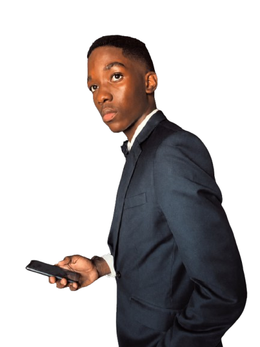
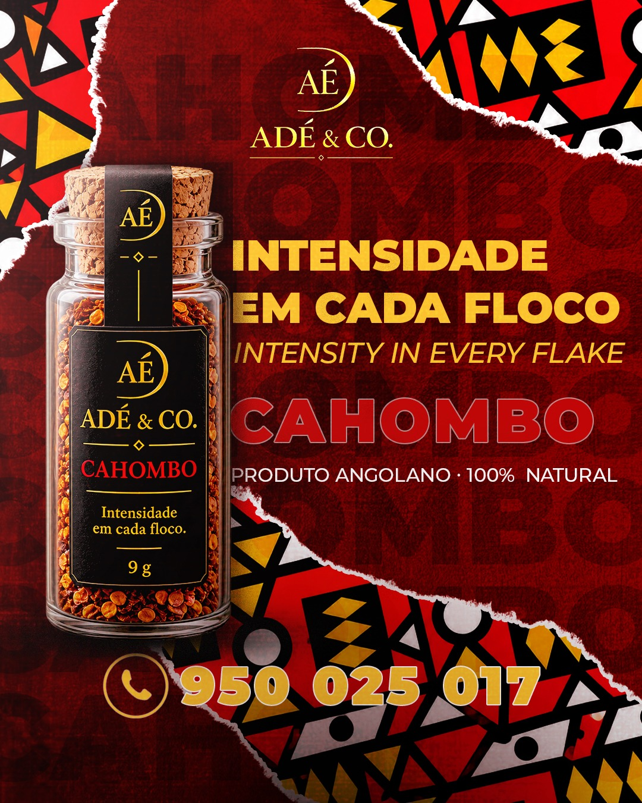
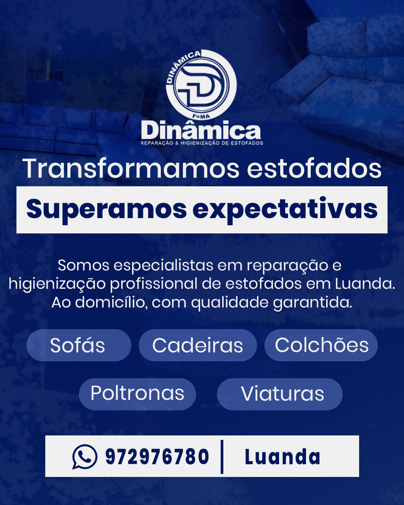
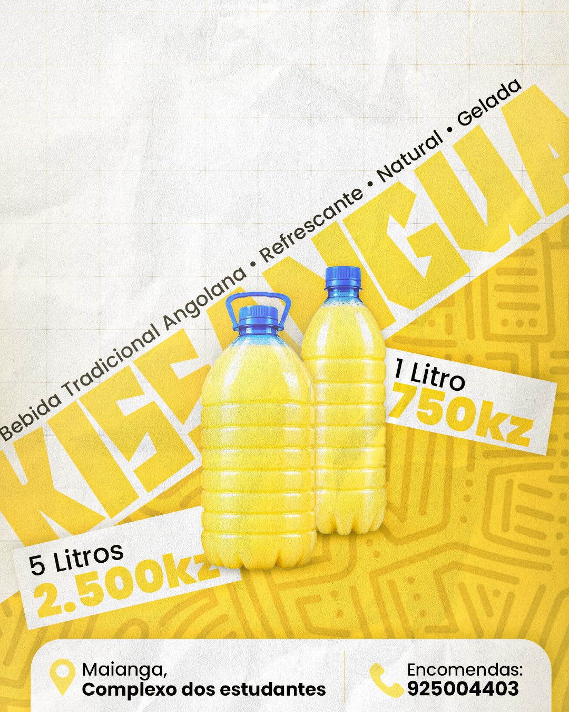

<div align="center">
  

  # Portfólio — Dário Yopilu

  **Site de portfólio estático para designer gráfico**, construído com HTML, CSS e JavaScript puros.

  [](https://developer.mozilla.org/docs/Web/HTML)
  [](https://developer.mozilla.org/docs/Web/CSS)
  [](https://developer.mozilla.org/docs/Web/JavaScript)

  <br />

  
  
  
</div>

---

## ✨ Sobre o projeto

Este repositório contém um portfólio pessoal com foco em **design gráfico, branding e publicidade**. A proposta é apresentar trabalhos, serviços, habilidades e contacto em uma experiência visual moderna, responsiva e sem dependências de build.

O código foi organizado para ser **legível e fácil de manter** (arquivos formatados, seções comentadas e estrutura clara), ideal tanto para uso real quanto para estudo.

## 🚀 Funcionalidades

- **Hero animado** com preloader, partículas, destaque visual e digitação de títulos
- **Navegação responsiva** com menu mobile e troca de idioma (PT/EN)
- **Portfólio interativo** com filtros por categoria e 9 projetos
- **Modal de projeto** com imagem 4:5, descrição, tags e navegação entre itens
- **Seções completas**: Sobre, Serviços, Portfólio, Habilidades e Contacto
- **Formulário de contacto** que abre conversa no WhatsApp com mensagem pré-preenchida
- **Efeitos visuais**: reveal no scroll, barras de skill animadas, contadores, tilt 3D e cursor personalizado (em dispositivos compatíveis)

## 🧰 Tecnologias

- **HTML5** — estrutura semântica da página
- **CSS3** — layout, tema, animações e responsividade
- **JavaScript (vanilla)** — interações, modal, filtros, i18n e animações
- **Google Fonts** — Inter e Space Grotesk

> Sem frameworks, bundlers ou backend: é um projeto 100% estático.

## 📁 Estrutura do projeto

```text
.
├── css/
│   └── style.css          # Estilos globais, componentes, modal e responsividade
├── img/
│   ├── profile.png        # Foto de perfil
│   ├── projeto1.jpg       # Projetos do portfólio (1–9)
│   ├── ...
│   └── projeto9.jpg
├── js/
│   └── main.js            # Lógica da interface e dados dos projetos
├── cv-dario-yopilu.pdf    # Currículo para download
├── favicon.svg            # Ícone do site
├── index.html             # Página principal
├── .prettierrc            # Configuração de formatação (Prettier)
└── .gitignore
```

## ▶️ Como executar localmente

Como o projeto é estático, você pode abrir `index.html` diretamente no navegador. Para uma experiência mais próxima de produção (e evitar restrições de alguns navegadores), use um servidor local:

```bash
# Opção 1 — Python
python -m http.server 8000

# Opção 2 — Node.js (serve)
npx serve .
```

Depois, acesse: `http://localhost:8000` (ou a porta indicada).

## 🛠️ Personalização rápida

- **Textos e seções:** edite `index.html`
- **Cores, layout e animações:** edite `css/style.css` (variáveis em `:root`)
- **Projetos do modal:** atualize o array `projectsData` em `js/main.js`
- **Cards do portfólio:** ajuste os blocos `.project-card` em `index.html` (IDs e categorias)
- **Contacto/links:** atualize email, telefone, redes sociais e número do WhatsApp em `index.html` e `js/main.js`
- **CV:** substitua `cv-dario-yopilu.pdf` e o link de download no hero

## 🌐 Deploy

Você pode publicar facilmente em qualquer hospedagem de sites estáticos:

- **GitHub Pages:** Settings → Pages → Deploy from branch (`main` / root)
- **Netlify / Vercel:** importe o repositório e publique sem comando de build

## 👤 Autor

**Dário Yopilu** — Designer Gráfico  
- Instagram: [@dany.design_](https://www.instagram.com/dany.design_)
- Behance: [dany-design](https://www.behance.net/dany-design)
- LinkedIn: [Dário Yopilu](https://www.linkedin.com/in/d%C3%A1rio-yopilu-863b063a7)

## 🙏 Créditos

- Imagens e peças exibidas no portfólio pertencem aos respectivos projetos de Dário Yopilu.
- Projeto desenvolvido com HTML, CSS e JavaScript puros para estudo e apresentação profissional.
